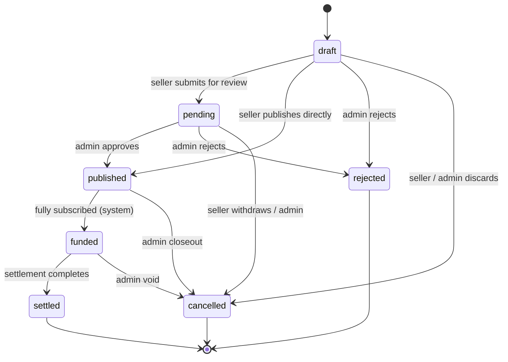

# Invoice Lifecycle

Invoice status changes go through a single state machine,
[`src/lib/invoice-state-machine.ts`](../src/lib/invoice-state-machine.ts). It
enforces the graph, the role allowed to take each step, and each step's
precondition. It also records every change in `invoice_status_history` and runs
side effects exactly once after the change commits.



In the terms used by issue #468: `draft` = submitted, `pending` = under review,
`published` = active.

## Transitions

| From → To                        | Allowed roles         | Precondition                         | Error when it fails                  |
| -------------------------------- | --------------------- | ------------------------------------ | ------------------------------------ |
| `draft → pending`                | seller (owner)        | `validateInvoiceForPublish()` passes | 422 `invoice_not_publishable`        |
| `draft → published`              | seller (owner)        | `validateInvoiceForPublish()` passes | 422 `invoice_not_publishable`        |
| `pending → published`            | admin                 | `validateInvoiceForPublish()` passes | 422 `invoice_not_publishable`        |
| `draft / pending → rejected`     | admin                 | non-empty reason                     | 422 `transition_precondition_failed` |
| `published → funded`             | system                | committed amount ≥ net amount        | 422 `transition_precondition_failed` |
| `funded → settled`               | admin, system         | —                                    | —                                    |
| `draft / pending → cancelled`    | seller (owner), admin | —                                    | —                                    |
| `published / funded → cancelled` | admin                 | —                                    | —                                    |

A transition that is not in the table is rejected with **422
`invalid_status_transition`**. A role that the table does not allow, or a seller
who does not own the invoice, is rejected with **403 `transition_not_permitted`**.
Invoice routes return these errors in a structured form:

```json
{
  "success": false,
  "error": {
    "code": "INVALID_STATUS_TRANSITION",
    "message": "Cannot transition invoice from funded to published. Allowed next statuses from funded: settled, cancelled.",
    "details": {
      "from": "funded",
      "to": "published",
      "allowedTransitions": ["settled", "cancelled"]
    }
  }
}
```

## History

Each transition writes a row to `invoice_status_history` in the same
database transaction as the status update: `from_status`, `to_status`,
`actor_role`, `actor_id`, `trigger` (e.g. `fully_funded`), `reason` and
`created_at`. The current status stays on `invoices.status`.

### History API (#795)

`GET /api/v1/invoices/:id/history?limit=&cursor=` returns one page of the
history, oldest first.

- **Access.** The invoice's seller and admins only. Any other caller, and any
  unknown invoice, gets the same `404 invoice_not_found`, so a caller cannot
  tell whether an invoice they may not see exists or has history. A cursor
  does not change that.
- **Order.** `(created_at, id)` ascending. Transitions written in one
  transaction share `created_at` (Postgres `now()` is fixed per transaction),
  so `id` breaks ties and the order is the same on every request.
- **Pages.** `limit` is 1–100, default 50. Pass `meta.nextCursor` back as
  `cursor` until `meta.hasMore` is false. Cursors are keyset positions that
  keep `created_at` to the microsecond, so pages have no gaps or repeats,
  and rows added later appear on later pages. A cursor is only valid for the
  invoice it came from.
- **Redaction.** `actorRole` (`seller`, `admin` or `system`), `trigger` and
  `reason` are always returned. `actorId` is returned to admins; sellers see
  it only for their own actions, and `null` for admin and system actors.

```http
GET /api/v1/invoices/6f1c9a52-8a0e-4d3c-9b0a-0c7c1f3e2a11/history?limit=2
Authorization: Bearer <seller token>
```

```json
{
  "success": true,
  "data": [
    {
      "id": "0d4f3c2a-…",
      "fromStatus": "draft",
      "toStatus": "pending",
      "actorRole": "seller",
      "actorId": "a1b2c3d4-…",
      "trigger": "seller_submitted",
      "reason": null,
      "createdAt": "2026-11-20T09:12:44.123Z"
    },
    {
      "id": "7e9a1b5c-…",
      "fromStatus": "pending",
      "toStatus": "rejected",
      "actorRole": "admin",
      "actorId": null,
      "trigger": "admin_rejected",
      "reason": "Document is unreadable",
      "createdAt": "2026-11-20T11:03:02.456Z"
    }
  ],
  "meta": { "limit": 2, "hasMore": true, "nextCursor": "eyJ2IjoxLC…" }
}
```

```http
GET /api/v1/invoices/6f1c9a52-8a0e-4d3c-9b0a-0c7c1f3e2a11/history?limit=2&cursor=eyJ2IjoxLC…
```

| Status | Code                | When                                              |
| ------ | ------------------- | ------------------------------------------------- |
| 400    | `invalid_limit`     | `limit` is not an integer from 1 to 100           |
| 400    | `invalid_cursor`    | Malformed cursor, or one from a different invoice |
| 401    |                     | No or invalid bearer token                        |
| 404    | `invoice_not_found` | Unknown invoice, or not the caller's to see       |

## Side effects

`InvoiceStateMachine.transition()` only validates and persists. Callers run
`dispatch()` after their transaction commits, so a rolled-back change never
notifies anyone. Dispatching the same transition twice is a no-op. The built-in
effects are:

- the `Invoice lifecycle state transition.` audit log
- a seller notification (when a notification service is configured)
- cache invalidation of `invoice:<id>`, `seller:<sellerId>:invoices` and
  `marketplace:listings` (when a `CacheInvalidator` is configured)

A failing effect is logged and does not block the others or fail the request.

## Notifications

In-app notifications are stored in the `notifications` table with a `read`
flag:

| Event                                                  | Recipients             | Type                 |
| ------------------------------------------------------ | ---------------------- | -------------------- |
| New investment                                         | investor, seller       | `investment_created` |
| Invoice funded                                         | seller, every investor | `invoice_funded`     |
| Invoice settled                                        | seller, every investor | `invoice_settled`    |
| Invoice rejected                                       | seller                 | `invoice_rejected`   |
| Other status changes (submitted, published, cancelled) | seller                 | `invoice`            |

"Every investor" means each user with a pending, confirmed or settled
investment in the invoice, notified once even if they hold several positions.
New-investment notifications are sent after the investment commits. A
notification that fails to store is logged and never fails the investment.

Authenticated users read their notifications through:

- `GET /api/v1/notifications`: paginated, filterable by `read` and `type`
- `GET /api/v1/notifications/unread-count`: `{ "unread": n }`
- `PATCH /api/v1/notifications/:id/read`
- `PATCH /api/v1/notifications/read-all`: one `UPDATE`, returns `{ "updated": n }`

## Endpoints

| Endpoint                                  | Transition                                                |
| ----------------------------------------- | --------------------------------------------------------- |
| `POST /api/v1/invoices/:id/submit`        | draft → pending                                           |
| `POST /api/v1/invoices/:id/publish`       | draft → published                                         |
| `POST /api/v1/invoices/batch-publish`     | draft → published (all or nothing)                        |
| `POST /api/v1/admin/invoices/:id/approve` | pending → published                                       |
| `POST /api/v1/admin/invoices/:id/reject`  | draft / pending → rejected                                |
| `POST /api/v1/invoices/:id/invest`        | published → funded, when the investment fills the invoice |
| `POST /api/v1/investments`                | published → funded, when the investment completes funding |
| `POST /api/v1/settlements/:invoiceId`     | funded → settled                                          |


## Draft deletion (#827)

`DELETE /api/v1/invoices/{id}` locks the invoice row and checks ownership and
the lifecycle graph inside one transaction. Deletion is limited to drafts and
records a draft to cancelled transition before soft deletion. Any investment
(including pending, cancelled, settled or soft deleted records), transaction,
secondary listing or trade, registered document, upload session, or attached
invoice CID prevents deletion with HTTP 409 `invoice_has_dependents`.
The standard error envelope includes `invoice_id` and the linked tables.
A draft with no dependents is cancelled, audited and deleted atomically.
Concurrent investment or document writers must use the same invoice row lock
or version precondition; they cannot attach activity to a deleted invoice.
